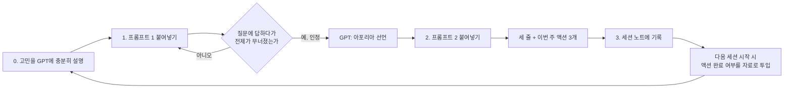

# 엘렌코스 사고 검증법

> [!summary] 한 줄 요약
> GPT에게 답을 시키지 말고 **소크라테스식 심문관** 역할을 시킨다. GPT는 질문만 던져 내가 근거 없이 깔고 있는 전제를 반례로 무너뜨리고, 내가 인정하면 "아포리아"(막다른 곳, 자신이 모른다는 것을 깨달은 상태)를 선언하고 멈춘다. 그다음 깨달음을 세 줄과 이번 주 액션 세 개로 바꾼다.

영상 썸네일의 "압박 수준이 S급"은 이 심문을 받는 쪽의 체감을 말한다. GPT가 답을 주지 않고 반례 질문만 계속 던지기 때문이다.

## 용어

| 용어 | 뜻 | 이 방법에서의 역할 |
|---|---|---|
| 엘렌코스 (elenchus) | 소크라테스가 상대의 주장에서 모순을 끌어내던 문답법. 반례를 질문으로 던져 전제를 스스로 철회하게 만든다 | 프롬프트 1·3의 핵심 동작 |
| 아포리아 (aporia) | 문답 끝에 도달하는 "길 없음"의 상태. 안다고 믿던 것이 무너져 모른다는 것을 인정하게 됨 | 심문의 종료 신호 |
| 정명 (正名) | 공자의 원칙. 이름(역할)과 실제(행동)를 일치시켜야 한다 | 프롬프트 3의 공자 차례 |
| 십이연기 (十二緣起) | 불교에서 괴로움이 생기는 열두 고리의 인과 사슬. 접촉에서 느낌, 갈애, 집착으로 이어진다 | 프롬프트 3의 부처 차례, 집착의 기원을 거슬러 추적 |

## 그대로 따라하는 순서

| 단계 | 할 일 | 사용 노트 |
|---|---|---|
| 0 | GPT에게 지금 고민·결정·계획을 평소처럼 충분히 말한다. 이 대화가 심문의 자료다. 자료가 없으면 심문도 공허하다 | - |
| 1 | 심문 시작 | [[프롬프트 1 - 소크라테스 엘렌코스 심문]] |
| 2 | 아포리아 선언 후 정리 | [[프롬프트 2 - 소크라테스가 남기는 말]] |
| 3 | 결과를 볼트에 기록. `Sessions/` 폴더에 템플릿으로 노트 생성 | [[아포리아 세션 기록]] |
| 선택 | 같은 전제가 여러 세션에서 반복해서 무너질 때 전문가 버전 사용 | [[프롬프트 3 - 삼중 아포리아 마스터 프롬프트]] |

## 비판적 검토

영상과 댓글은 권위("하버드 석좌교수")와 자극("미친", "S급")으로 포장돼 있지만, 기법 자체는 고전적인 소크라테스 문답법을 LLM(대규모 언어 모델)에 역할로 얹은 것이다. 모델 세대(GPT-6)와는 무관하게 어떤 모델에서도 동작한다. 실제로 쓸 때 걸리는 지점은 다음과 같다.

| 문제 | 왜 문제인가 | 보완 |
|---|---|---|
| 자료 의존 | 프롬프트가 "지금까지 나눈 대화"를 자료로 삼는다. 새 채팅에서 바로 던지면 모델이 전제를 지어낸다 | 먼저 10분 이상 고민을 설명하거나, 노트를 붙여넣는 변형을 쓴다 |
| 아첨 (sycophancy, 사용자 비위를 맞추는 모델의 성향) | 모델이 내가 조금만 반박해도 물러서거나, 반대로 억지 반례를 만들 수 있다 | 반례가 사실인지 따로 확인한다. "그 반례의 근거를 한 줄로"를 요구한다 |
| 종료 조건 부재 | 프롬프트 3의 "겹칠 때까지 계속"은 무한 루프가 될 수 있고, 모델이 수렴을 연출할 수 있다 | 라운드 상한(3바퀴)과 "세 틀의 지점을 따로 써서 보여줘"를 추가한다 |
| 피로 | 답을 주지 않는 질문 공세는 20분을 넘기면 방어적으로 변한다 | 질문 7개 상한. 아포리아가 안 나오면 "오늘은 여기까지"로 끊고 기록한다 |
| 깨달음의 휘발 | 심문 직후의 통찰은 하루면 사라진다 | 프롬프트 2의 액션 세 개를 반드시 체크박스로 기록하고 다음 세션 자료로 되먹인다 |

## 더 좋게 쓰는 법 (내 제안, 원문에는 없음)

- **전제 추적.** 세션 노트의 `무너진 전제` 필드를 Dataview로 모아 본다. 같은 전제가 세 번 이상 무너지면 그것이 진짜 핵심 편향이다. 한 번의 심문보다 이 누적이 가치가 크다.
- **되먹임 루프.** 다음 세션 첫 문장을 "지난주 액션 3개 중 2개만 했다. 안 한 이유는 ..."으로 시작한다. 실행 실패 자체가 가장 좋은 심문 자료다.
- **역할 선언 노트.** 공자 차례(정명)를 제대로 쓰려면 "내가 스스로 붙인 역할 이름" 목록이 필요하다. `나는 ○○이다`라고 믿는 역할을 한 노트에 적어 두고 프롬프트 3에 함께 붙인다.
- **반례 검증 단계.** 아포리아 선언 전에 "방금 반례가 실제 사례인지, 가정인지 표시해"를 끼운다. 가정뿐인 반례로 전제를 버리면 더 나쁜 결정이 된다.

## 출처

- 영상과 고정 댓글: [[하버드 교수가 쓰는 GPT-6 활용법 - GPT 연대경영]]
